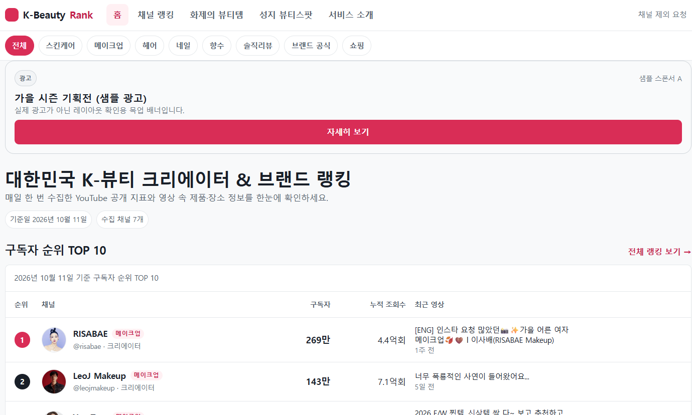
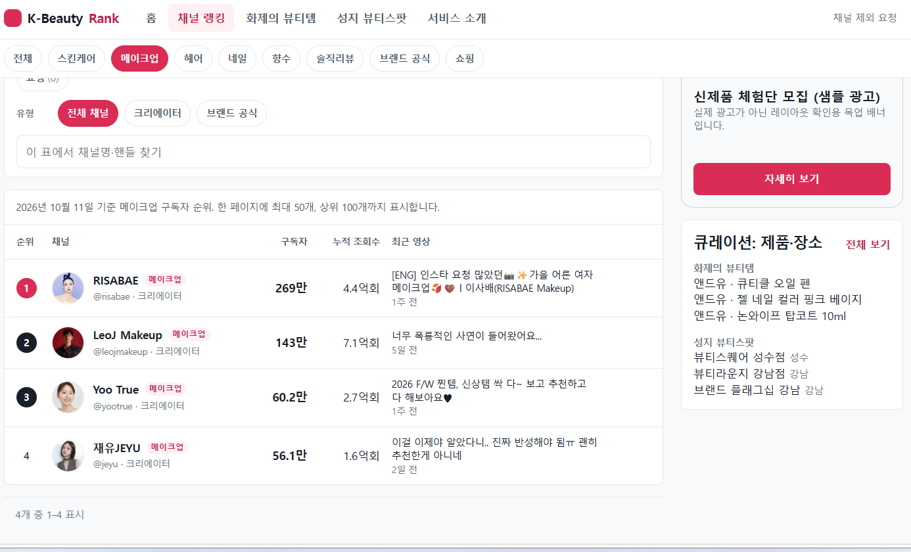

# K-beauty 채널 랭킹

| 홈 | 랭킹 보드 (메이크업) |
|---|---|
|  |  |

K-beauty 유튜브 채널 구독자·조회수 순위와 영상 속 제품·장소 정보를 보여주는 서버 렌더링 사이트. 기술명세서: [kbeauty-ranking-spec.md](kbeauty-ranking-spec.md), UI 시안: `xref/stitch_app_ui_design_project/`.

## 현재 상태 (UI 우선 단계)

화면은 `data/youtube.json`(YouTube Data API로 수집)이 있으면 **실제 채널·영상 데이터**를, 없으면 목업 데이터를 쓴다. Neon DB는 아직 연결하지 않았다.

| 영역 | 상태 |
|---|---|
| 화면 (홈·랭킹·채널·제품·장소·about·takedown), SEO, 접근성, 보안 헤더 | 완료 (목업 데이터) |
| 증가 보드·순위 변동 | 코드 완료, `FEATURE_DERIVED_METRICS=true`일 때만 노출 (승인 후) |
| YouTube 수집 (`npm run check-channels`, `npm run ingest`) → 로컬 JSON | 완료 |
| 개발용 상태 점검 화면 (`/dev/status`, 로컬 전용) | 완료 |
| Neon 연결, 마이그레이션 적용·`seed.js`, 수집·정리 크론, Vercel 배포 | 미구현 (`api/cron/*`는 501 스텁) |

## 실행

```bash
npm install
npm run dev        # http://localhost:3000  (PORT 환경변수로 변경)
npm test           # Vitest 단위 테스트
node scripts/gen-mock-seed.js   # 목업 mentions.csv 재생성 (channels.csv는 건드리지 않음)
```

환경변수는 [.env.example](.env.example) 참고. `MOCK_XSS=1`이면 이스케이프 확인용 채널이 추가된다.

## 구조

- `api/page.js` 모든 화면 라우팅 → `lib/render/*` HTML 조립 (`html` 태그 템플릿이 값을 자동 이스케이프)
- `lib/data/mock.js` **유일한 데이터 원천**. Neon 연결 시 같은 함수 이름으로 SQL 구현(`lib/data/db.js`)을 만들어 교체한다
- `lib/ranking.js` 보드 계산(동률 `rank()`, 제목순, 상위 100·페이지당 50)
- `db/migrations/` 명세 5장 DDL, `db/seed/` CSV 원본
- `scripts/dev.js` 로컬 서버 (vercel.json의 보안 헤더를 동일 적용)

## 디자인 대비 명세 우선 처리

Stitch 시안 중 아래는 명세(YouTube 정책)와 충돌해 구현하지 않았다: 전체 구독자 합계 등 시장 통계 타일, 카테고리 비중 카드, A단계의 증가수·▲▼ 표시, 로그인 아이콘, 지도 모아보기, 스톡 제품 사진. 증가 표시는 플래그 뒤로 옮겼다.

## 알아둘 점

- 목업의 YouTube 링크(`mockvid…`)와 `example.com` 구매 링크는 실제로 열리지 않는다.
- 글꼴은 Pretendard를 우선 지정했지만 파일을 포함하지 않아 시스템 글꼴로 대체된다. 자체 호스팅하려면 `public/fonts/`에 추가하고 `styles.css`에 `@font-face`를 넣는다.
- `public/og.png`(기본 OG 이미지)와 `robots.txt`의 Sitemap 줄은 도메인 확정 후 추가한다.
- 명세의 "확인 필요" 항목(`id` 최대 50개, 구독자 반올림, rewrite 충돌, 썸네일 도메인 등)은 로드맵 2단계 검증 때 이 README의 "검증 기록"에 적는다.

## 검증 기록

(로드맵 2단계에서 작성)
