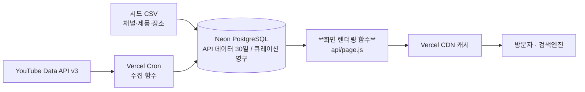

# K-beauty 채널 랭킹 기술명세서

작성일: 2026-10-11

## 1. 범위와 가정

수동으로 고른 K-beauty 유튜브 채널 200\~500개를 하루 한 번 수집해 구독자·조회수 순위와 30일 변화 추이를 보여주고, 영상에 나온 제품·장소 정보로 수익화하는 SEO 중심 랭킹 사이트를 Vercel에 배포한다. 서비스 이름은 가칭 "K-beauty 채널 랭킹"이다.

**벤치마크**: PlayBoard의 구성(채널 순위, 급상승 순위, 주제별 차트, 채널 상세)을 따르되, 데이터 범위는 K-beauty 한 분야로 좁히고 장소·제품 정보를 더한다.

**MVP에 포함 (P0)**

- 채널 시드 200\~500개 (CSV 파일, 카테고리 태그 포함)
- 하루 1회 수집: `channels.list`로 채널 지표, `playlistItems.list`로 업로드 목록 (`search.list` 사용 안 함)
- 랭킹 보드 4종: 구독자·누적 조회수(원본 수치 정렬), 구독자 증가·조회수 증가 (7일·30일 기준, 파생 지표라 승인 후 활성화, 2장)
- 채널 상세 페이지: 지표 추이(최대 30일)와 최근 영상
- 장소·제품 카드: 직접 큐레이션한 데이터와 영상 연결
- 검색엔진 유입 대응: 서버 렌더링 HTML, 사이트맵, 메타·OG 태그, 구조화 데이터
- 채널 제외 요청 창구 (요청 후 7일 안에 삭제)
- 스폰서 배너 슬롯 1\~2개 (고정 이미지, 영상 플레이어 밖)

**MVP에서 제외 (백로그)**

- 회원가입·로그인, 결제 (유료 서비스는 2단계)
- 30일을 넘는 이력 (월간·연간 추이): 2장의 약관 제약 때문에 승인 후 추가
- 외부에 제공하는 공개 API, 관리자 화면, 알림·구독 기능
- 채널 자동 발굴, 해외 채널·다른 분야 확장

**전제**

- Vercel Hobby 플랜과 Neon 무료 플랜으로 시작하고, 필요하면 유료로 올린다.
- 채널 시드 목록은 사용자가 직접 모은다. 이 문서는 목록 형식과 검증 방법만 정의한다.
- 한국어 UI이며, 이용자 개인정보는 받지 않는다 (접속 로그 제외).
- 기술 트랙은 입문자 트랙(빌드 도구 없는 HTML/CSS/JS)을 확장한 형태다. 이유는 3장에 쓴다.

**성공 기준 (목표값)**

1. 채널 200개 기준 일일 수집이 하루 쿼터(10,000 units)의 10% 안에서 끝난다 (4장에서 계산).
2. 랭킹 페이지를 JS 없이 열어도 순위 표가 HTML에 들어 있다.
3. 스냅샷이 30일치 쌓인 뒤 30일 원본 추이 그래프가 정상 표시되고(승인 후에는 증가 보드도), 30일을 넘은 데이터는 자동 삭제된다.
4. 제품·장소 카드가 각 30개 이상 있고 영상과 연결되어 있다.

## 2. YouTube API 약관 제약과 설계 원칙

여러 소유자의 채널을 모아 순위·증가율을 보여주는 이 서비스는 [YouTube API 개발자 정책](https://developers.google.com/youtube/terms/developer-policies)의 세 조항(집계, 파생 지표, 30일 보관)과 충돌할 수 있다. 그래서 공개 전에 YouTube의 감사·쿼터 연장 승인을 신청하는 것을 전제로 설계한다. 원문이 법적 기준이므로 구현 시점에 다시 대조한다.

| 조항 | 정책 내용 | 이 서비스에 미치는 영향 | 설계 대응 |
| --- | --- | --- | --- |
| III.E.2.a 집계 | 같은 콘텐츠 소유자의 채널 데이터만 집계할 수 있고, 결과는 그 소유자만 볼 수 있다 | 서로 다른 소유자의 채널을 하나의 순위로 모으는 것과 충돌할 수 있다 (해석 불확실) | 공개 전 감사·쿼터 연장 신청서에 용도를 설명하고 승인을 받는다. 승인 전에는 시연용으로만 쓴다 |
| III.E.2.b 사업 인사이트 | YouTube 사용량·수익 같은 사업 인사이트를 얻기 위한 집계를 금지한다 | 랭킹이 시장 통계로 해석될 여지가 있다 | 개별 채널의 원본 수치만 표시한다. 분야 전체 합계·평균 같은 시장 지표는 만들지 않는다 |
| III.E.4.h 파생 지표 | API 데이터로 새 파생 데이터·지표(좋아요·조회수를 반영한 점수 등)를 만들 수 없다 | 증가수·증가율·순위 변동은 파생 지표로 볼 수 있다 | 증가 보드는 기능 플래그로 끄고, III.L 승인 후에만 켠다. 자체 종합 점수는 어느 단계에서도 만들지 않는다 |
| III.E.4.b–d 보관 기간 | 인증되지 않은 통계(구독자 수 등)는 30일을 넘겨 보관할 수 없다 | PlayBoard식 장기 이력은 승인 없이 불가능하다 | 스냅샷을 30일 롤링으로 보관하고 매일 삭제 작업을 돌린다 (`RETENTION_DAYS=30`) |
| III.L 추가 정책 (2026) | 감사를 받은 분석 용도 개발자가 표준 쿼터 연장 신청서로 명시적으로 신청하면 파생 지표·통계 저장 허가를 받을 수 있다 | 증가 보드와 30일 초과 이력의 유일한 합법 경로 | 세부 범위는 별도 문서에 있어 신청 전에 읽고 확인한다 |
| III.G.1.c 광고 | 영상·플레이어 안 또는 위에 놓이는 광고·후원 판매는 사전 서면 승인이 필요하다 | 스폰서 배너 위치에 제약이 있다 | 배너는 플레이어 밖의 별도 영역에만 둔다. 임베드 위·안에는 두지 않는다 |
| III.G.1.d 광고 페이지 | YouTube 데이터가 있는 페이지에 광고를 판매하려면 같은 페이지에 YouTube 외 출처의 콘텐츠도 있어야 한다 | 배너가 들어가는 모든 페이지에 자체 콘텐츠가 필요하다 | 배너가 있는 페이지에는 직접 큐레이션한 제품·장소 정보 블록을 반드시 함께 넣는다 (7장과 연결) |
| III.I.1 대체 금지 | YouTube 앱을 대체하거나 실질적으로 유사한 서비스를 만들 수 없다 | 영상 시청 중심이 되면 안 된다 | 채널·영상은 YouTube로 연결하고, 사이트의 중심은 순위와 제품·장소 정보로 둔다 |
| 삭제 요청 | 사용자 삭제 요청은 7일 이내 처리해야 한다 | 채널 운영자의 제외 요청에 대비가 필요하다 | 제외 요청 창구를 두고 7일 안에 데이터를 삭제한다 |

**설계 원칙**

1. 순위는 API가 준 원본 필드(구독자 수, 누적 조회수)를 정렬한 결과만 쓴다. 가중치를 섞은 종합 점수는 만들지 않는다.
2. API 응답 본문(제목·수치)은 30일 안에 갱신하거나 삭제한다. 우리가 붙인 연결 정보(영상 ↔ 제품·장소)는 우리 자산이라 계속 보관할 수 있다.
3. 유료화 대상은 YouTube 통계가 아니라 우리가 큐레이션한 제품·장소 데이터와 연계 서비스로 한다. API 데이터 접근권을 판매하는 것은 사전 서면 승인이 필요하다.
4. 스크래핑과 문서화되지 않은 API는 쓰지 않는다. 채널 발굴도 담당자가 직접 한다.
5. 승인 여부에 따라 켜고 끄는 기능은 환경변수 플래그로 분리해, 거절되어도 나머지 서비스가 유지되게 한다.

**단계별 운영 (기능 플래그)**

| 단계 | 공개 여부 | 켜지는 기능 | 플래그 |
| --- | --- | --- | --- |
| A. 개발·시연 | 비공개(본인 확인용) | 원본 수치 순위(구독자·누적 조회수), 30일 원본 추이 그래프 | 기본값 |
| B. 감사·연장 신청 | 비공개 또는 제한 공개 | 동일 + 신청용 화면·용도 설명 자료 | 기본값 |
| C. 승인 후 공개 | 공개 | 증가 보드(7일·30일), 순위 변동, 필요 시 30일 초과 이력 | `FEATURE_DERIVED_METRICS=true` |

승인이 나지 않으면 서비스는 원본 순위와 제품·장소 정보 중심으로 방향을 바꾼다. 13장의 리스크에 이 경우의 대안을 적는다.

## 3. 아키텍처와 폴더 구조

수집은 Vercel Cron이 하루 한 번 호출하는 서버리스 함수가 맡고, 페이지는 서버리스 함수가 DB에서 읽어 HTML로 만들어 CDN에 캐시한다. 브라우저는 YouTube API와 DB에 직접 접속하지 않는다.



*그림: 시스템 구성 (수집, 저장, 렌더링 흐름)*

굵게 표시한 화면 렌더링 함수가 검색엔진이 읽는 HTML을 만든다. 수집·렌더링은 Vercel, 저장은 Neon이 맡는다.

**기술 트랙 선택: 입문자 트랙 확장 (서버 렌더링 HTML)**

- 검색 유입이 핵심이라 처음 받는 HTML에 순위 표가 들어 있어야 한다. React + Vite는 브라우저가 화면을 그리는 방식(CSR)이라 이 요구에 불리하다.
- 서버리스 함수가 템플릿 문자열로 HTML을 조립하고, `vercel.json`의 rewrites로 URL을 함수에 연결한다. 브라우저 JS는 정렬·필터 같은 보조 동작만 한다.
- 화면과 상태가 크게 늘면 Next.js 도입을 이유와 함께 제안하고 합의한 뒤 진행한다. 지금은 도입하지 않는다.

**기술 스택**

| 구성 | 선택 | 역할 |
| --- | --- | --- |
| 화면 | 서버 렌더링 HTML + CSS + 바닐라 JS | 랭킹·채널·제품·장소 페이지 |
| 서버 | Vercel Serverless Functions (Node.js) | 페이지 렌더링, 수집, 삭제 요청 접수 |
| 스케줄 | Vercel Cron Jobs | 일일 수집과 정리 작업 호출 |
| DB | Neon PostgreSQL (`@neondatabase/serverless`, pooled 연결) | 스냅샷·큐레이션 데이터 보관 |
| 검증 | Zod | 요청 입력과 시드 CSV 검증 |
| 데이터 소스 | YouTube Data API v3: `channels.list`, `playlistItems.list`, `videos.list` | 채널 지표와 업로드 영상 |
| SEO | sitemap.xml, robots.txt, JSON-LD | 검색 노출 |

**Vercel Cron 제약 (공식 문서 확인)**

- Hobby 플랜은 하루 1회만 실행할 수 있고, 실행 시각이 지정한 시간대 안에서 최대 59분 흔들린다. 더 자주 돌리는 표현식은 배포가 실패한다.
- 실패해도 재시도하지 않고, 드물게 누락되거나 중복 호출될 수 있다. 수집 함수는 두 번 돌아도 결과가 같아야 한다(중복 저장 방지는 5장의 유니크 키).
- 크론 요청은 `CRON_SECRET` 환경변수가 `Authorization: Bearer ...` 헤더로 자동 전달되어, 함수가 값을 비교해 검증한다.
- 크론 실행 시간 제한은 일반 서버리스 함수와 같다. 수집을 단계로 쪼개는 이유다(4장).
- 로컬에서는 크론 스케줄이 동작하지 않으므로 엔드포인트를 직접 호출해 테스트한다.

**폴더 구조**

```
/
├─ api/
│  ├─ page.js              # 모든 화면 요청을 받아 HTML 렌더링 (vercel.json rewrites)
│  ├─ sitemap.js           # sitemap.xml 생성
│  ├─ health.js            # 상태 확인
│  ├─ takedown.js          # 채널 제외 요청 접수 (POST)
│  └─ cron/
│     ├─ ingest.js         # 일일 수집 (단계별)
│     └─ cleanup.js        # 30일 초과 데이터 삭제
├─ lib/
│  ├─ db.js                # Neon 연결
│  ├─ youtube.js           # YouTube API 호출 래퍼 (쿼터 카운터 포함)
│  ├─ ranking.js           # 보드별 조회 쿼리
│  ├─ render/              # 화면별 HTML 조립 (home, board, channel, product, place)
│  ├─ seo.js               # 메타·OG·JSON-LD
│  └─ validate.js          # Zod 스키마
├─ public/                 # styles.css, app.js, favicon, robots.txt, banners/
├─ db/
│  ├─ migrations/
│  └─ seed/                # channels.csv, products.csv, places.csv, mentions.csv
├─ scripts/                # seed.js, check-channels.js
├─ vercel.json             # rewrites, crons
├─ package.json
├─ .env.example
├─ .gitignore
└─ README.md
```

`vercel.json`은 rewrites와 crons에 필요해서 둔다(프로젝트 규칙상 꼭 필요한 경우).

## 4. 데이터 수집 설계

채널 500개를 매일 수집해도 최악의 경우 하루 약 610 units(일일 쿼터 10,000의 6%)만 쓴다. `search.list`를 쓰지 않고 채널 지표·업로드 재생목록만 읽기 때문이다.

**시드(채널 목록) 형식**

`db/seed/channels.csv`를 저장소에 둔다. `npm run seed`는 같은 파일을 여러 번 실행해도 결과가 같다(upsert).

```csv
channel_id,category,is_brand,note
UCxxxxxxxxxxxxxxxxxxxxxx,skincare,false,피부 진단 리뷰 중심
UCyyyyyyyyyyyyyyyyyyyyyy,makeup,true,브랜드 공식 채널
```

| 컬럼 | 규칙 |
| --- | --- |
| `channel_id` | 필수. `UC`로 시작하는 24자, 중복 불가 (정규식 `^UC[\w-]{22}$`) |
| `category` | 필수. `skincare`, `makeup`, `hair`, `nail`, `fragrance`, `review`, `brand`, `shop` 중 하나 (Zod enum) |
| `is_brand` | 브랜드 공식 채널 여부. 크리에이터 보드와 분리해서 보여줄 때 쓴다 |
| `note` | 내부 메모. 화면에 노출하지 않는다 |

- 채널 ID를 모르고 핸들(@이름)만 알면 `scripts/check-channels.js`가 `channels.list`로 변환한다(핸들 1개당 1 unit, 핸들 조회 파라미터의 지원 여부는 구현 시 확인 필요).
- 시드 검증 스크립트는 존재하지 않는 ID와 중복을 시드 반영 전에 잡아낸다.

**쿼터 예산**

| 단계 | 메서드 | 호출당 원칙 | 200개 채널 (units) | 500개 채널 (units) |
| --- | --- | --- | --- | --- |
| 1. 채널 지표 | `channels.list` | id 최대 50개씩 묶음 | 4 | 10 |
| 2. 업로드 목록 | `playlistItems.list` | 채널 1개당 1회, 최근 10개 | 200 | 500 |
| 3. 영상 지표 | `videos.list` | id 최대 50개씩 묶음 | 40 | 100 |
| 합계 (최악) |  |  | 244 | 610 |
| 일일 쿼터 대비 |  |  | 2.4% | 6.1% |

- 쿼터 비용은 [공식 쿼터 표](https://developers.google.com/youtube/v3/determine_quota_cost)의 값(이 세 메서드 1 unit)을 쓴다. 하루 10,000 units는 `search.list`와 `videos.insert`를 제외한 공통 한도다.
- `id`에 넣을 수 있는 최대 개수(50)는 공식 참조 페이지에 명시되어 있지 않다. 실무에서 쓰는 값이라 50으로 잡고, 51개를 넣어 오류가 나는지 로드맵 1단계에서 직접 확인한다(확인 필요).
- 2단계는 절감할 수 있다. 채널 지표의 `videoCount`가 어제와 같으면 그 채널의 업로드 목록은 건너뛴다. 주 1회인 채널이 많으면 하루 실제 사용량이 위 표의 절반 이하로 떨어진다. 일주일에 한 번은 전체를 새로 읽는다.
- 쿼터 추정치는 실제 운영 중 Google Cloud 콘솔 쿼터 화면의 사용량과 대조한다.

**일일 파이프라인 (Vercel Cron)**

Hobby 플랜은 실행 시각이 지정한 시간대 안에서 흔들리므로, 단계 사이를 2시간 이상 띄어 순서가 뒤집히지 않게 한다. 크론 항목은 하루 1회씩, 프로젝트당 100개까지 등록할 수 있다.

| 단계 | cron (UTC) | 한국 시간 | 경로 | 작업 |
| --- | --- | --- | --- | --- |
| 1 채널 | `0 1 * * *` | 10:00\~10:59 | `/api/cron/ingest?stage=channels` | `channels.list` 일괄 호출, 일일 스냅샷 저장 |
| 2 업로드 | `0 3 * * *` (청크 5개) | 12:00\~12:59 | `/api/cron/ingest?stage=uploads&chunk=0..4` | 채널 100개씩 나눠 `playlistItems.list` |
| 3 영상 | `0 5 * * *` | 14:00\~14:59 | `/api/cron/ingest?stage=videos` | 새 영상의 `videos.list` |
| 4 정리 | `0 7 * * *` | 16:00\~16:59 | `/api/cron/cleanup` | 30일 초과 데이터·제외 채널 삭제 |

- 단계 2의 청크 수는 채널 수에 맞춰 늘린다(100개당 크론 1줄). 청크 하나가 실패해도 나머지는 영향을 받지 않는다.
- 청크의 크기(`INGEST_CHUNK_SIZE`)는 함수 최대 실행시간에 맞게 조절한다. 플랜별 한도는 배포 때 `maxDuration` 설정과 함께 확인한다(확인 필요).
- 모든 단계는 두 번 실행돼도 안전하다. 스냅샷은 `(channel_id, snapshot_date)`가 같으면 덮어쓴다.
- 단계마다 `ingest_runs` 테이블에 시작·종료 시각, 사용 units, 상태, 오류를 남긴다. 누락된 날은 다음 실행이 이어서 처리한다.

**오류·예외 처리**

- 쿼터 초과(HTTP 403 `quotaExceeded`)가 나면 해당 단계를 중단하고 `partial`로 기록한다. 자체 소프트 한도(`QUOTA_SOFT_LIMIT`, 기본 8,000 units)를 넘기 전에 스스로 멈춘다.
- 당일 스냅샷이 없는 채널은 가장 최근 스냅샷을 쓰되 화면에 기준일을 표시한다.
- `channels.list` 응답에 빠진 ID는 연속 3회 빠지면 `status='missing'`으로 바꾸고 랭킹에서 빼되 삭제하지는 않는다(사람이 확인).
- 구독자 수를 숨긴 채널(`hiddenSubscriberCount`)은 구독자 보드에서 빼고 "비공개"로 표시한다.

## 5. 데이터 모델

데이터는 YouTube에서 받은 값(스냅샷·영상 지표)과 우리가 만든 값(제품·장소·연결 정보)으로 나뉘고, 앞의 것은 30일 안에 갱신하거나 삭제한다. 스키마 변경은 항상 `db/migrations/`의 SQL 파일로 남기고 `scripts/migrate.js`로 적용한다. 규모가 커지면 Drizzle ORM을 제안한다. Neon 브랜치는 `dev`, `preview`, `main`으로 나눠 쓴다.

```sql
-- db/migrations/0001_init.sql
create table channels (
  channel_id          text primary key check (channel_id ~ '^UC[\w-]{22}$'),
  title               text,                      -- YouTube 데이터 (30일 안 갱신)
  handle              text,
  thumbnail_url       text,
  country             text,
  uploads_playlist_id text,
  category            text not null check (category in
                        ('skincare','makeup','hair','nail','fragrance','review','brand','shop')),
  is_brand            boolean not null default false,   -- 우리 데이터
  note                text,                              -- 우리 데이터, 비공개
  status              text not null default 'active'
                        check (status in ('active','missing','excluded')),
  last_refreshed_at   timestamptz,
  created_at          timestamptz not null default now(),
  updated_at          timestamptz not null default now()
);

create table channel_snapshots (
  channel_id        text not null references channels(channel_id) on delete cascade,
  snapshot_date     date not null,                      -- 한국 시간 기준 날짜
  subscriber_count  bigint,                             -- 숨김 시 null
  hidden_subscribers boolean not null default false,
  view_count        bigint not null,
  video_count       integer not null,
  created_at        timestamptz not null default now(),
  primary key (channel_id, snapshot_date)
);
create index on channel_snapshots (snapshot_date, subscriber_count desc);
create index on channel_snapshots (snapshot_date, view_count desc);

create table videos (
  video_id      text primary key,
  channel_id    text not null references channels(channel_id) on delete cascade,
  title         text,
  published_at  timestamptz,
  thumbnail_url text,
  view_count    bigint,
  fetched_at    timestamptz not null default now()      -- 30일 안 갱신
);
create index on videos (channel_id, published_at desc);

create table products (
  product_id   uuid primary key default gen_random_uuid(),
  slug         text not null unique,
  brand        text not null,
  name_ko      text not null,
  category     text not null,
  price_krw    numeric(12,0),
  description  text,
  buy_url      text,
  is_affiliate boolean not null default false,
  created_at   timestamptz not null default now(),
  updated_at   timestamptz not null default now(),
  deleted_at   timestamptz
);

create table places (
  place_id     uuid primary key default gen_random_uuid(),
  slug         text not null unique,
  name_ko      text not null,
  place_type   text not null,        -- oliveyoung, popup, salon, brand_store, cafe 등
  district     text,                 -- 예: 성수, 명동, 강남
  address      text,
  lat          numeric(9,6),
  lng          numeric(9,6),
  website_url  text,
  description  text,
  created_at   timestamptz not null default now(),
  updated_at   timestamptz not null default now(),
  deleted_at   timestamptz
);

-- 영상에 어떤 제품·장소가 나왔는지에 대한 우리의 주석 (영상 ID만 보관, 영상 본문은 보관하지 않음)
create table video_mentions (
  id           bigint generated always as identity primary key,
  video_id     text not null,
  channel_id   text not null references channels(channel_id) on delete cascade,
  product_id   uuid references products(product_id),
  place_id     uuid references places(place_id),
  start_sec    integer,
  source       text not null default 'manual' check (source in ('manual','ai_reviewed')),
  created_at   timestamptz not null default now(),
  check ((product_id is null) <> (place_id is null))
);
create unique index on video_mentions (video_id, product_id) where product_id is not null;
create unique index on video_mentions (video_id, place_id) where place_id is not null;
create index on video_mentions (channel_id);

create table sponsors (
  id          bigint generated always as identity primary key,
  name        text not null,
  image_path  text not null,
  link_url    text not null,
  placement   text not null check (placement in ('home_top','board_side','channel_side')),
  starts_on   date not null,
  ends_on     date not null,
  is_active   boolean not null default true
);

create table takedown_requests (
  id            bigint generated always as identity primary key,
  channel_id    text,
  contact_email text not null,
  message       text,
  status        text not null default 'received'
                  check (status in ('received','done','rejected')),
  received_at   timestamptz not null default now(),
  due_at        timestamptz not null default now() + interval '7 days',
  resolved_at   timestamptz
);

create table ingest_runs (
  id                 bigint generated always as identity primary key,
  stage              text not null,
  chunk              integer,
  started_at         timestamptz not null default now(),
  finished_at        timestamptz,
  status             text not null default 'running'
                       check (status in ('running','ok','partial','failed')),
  units_used         integer not null default 0,
  channels_processed integer not null default 0,
  error              text
);
```

**보관·삭제 규칙**

| 데이터 | 출처 | 보관 기간 | 삭제 방식 (`/api/cron/cleanup`) |
| --- | --- | --- | --- |
| `channel_snapshots` | YouTube API | 최근 30개 날짜(오늘 포함) | `snapshot_date < 오늘(KST) - 29일`인 행 삭제 |
| `videos` | YouTube API | 30일 | `fetched_at < now() - 30일`인 행 삭제 |
| `channels`의 제목·썸네일 등 | YouTube API | 30일 | `last_refreshed_at`가 30일 넘으면 해당 열을 null로 비우고 화면에서 숨긴다 |
| `takedown_requests` | 사용자 입력 | 처리 완료 후 30일 | 이메일을 비우고 처리 이력만 남긴다 |
| `channels`의 `category`·`is_brand`·`note`, `products`, `places`, `video_mentions`, `sponsors` | 우리 데이터 | 영구 | 지울 때는 `deleted_at` 또는 직접 삭제 |

- `status='excluded'`로 바뀐 채널은 다음 정리 때(최대 하루 이내) 스냅샷·영상을 모두 삭제한다. 삭제 요청 접수 후 7일 이내 처리를 지키는 구조다.
- `video_mentions`는 영상 ID만 가지고 있어, `videos` 행이 지워진 뒤에도 "이 채널의 영상에 이 제품이 나왔다"는 정보는 유지된다. 영상 제목이 없으면 YouTube 링크만 보여준다.
- 수집 함수가 다시 실행돼도 안전하도록 스냅샷은 `insert ... on conflict (channel_id, snapshot_date) do update`로 저장한다. 모든 SQL은 파라미터 바인딩만 쓴다.

## 6. 랭킹·변화율 산출 명세

순위는 최신 일일 스냅샷의 원본 수치를 내림차순 정렬한 것이고, 증가 보드는 두 시점 스냅샷의 차이로 만든다. 후자는 2장의 파생 지표 제한 때문에 승인 후(`FEATURE_DERIVED_METRICS=true`)에만 켠다.

**보드 정의**

| 보드 | 정렬 기준 | 활성 단계 | 필터 | 표시 항목 |
| --- | --- | --- | --- | --- |
| 구독자 순위 | `subscriber_count` 내림차순 | A (기본) | 카테고리, 크리에이터/브랜드 | 순위, 채널, 구독자 수, 기준일 |
| 누적 조회수 순위 | `view_count` 내림차순 | A (기본) | 위와 동일 | 순위, 채널, 누적 조회수, 기준일 |
| 구독자 증가 | 증가수 내림차순 (증가율 병기) | C (승인 후) | 7일 · 30일, 카테고리 | 순위, 순위 변동, 증가수, 증가율 |
| 조회수 증가 | 증가수 내림차순 (증가율 병기) | C (승인 후) | 7일 · 30일, 카테고리 | 위와 동일 |

- 채널 상세의 "지표 추이 그래프"는 저장된 일별 원본 값(구독자·조회수)을 선으로 이어 보여주는 것이라 A단계에서도 표시한다. 그래프에는 증가수와 증가율을 써넣지 않는다.
- 한 보드당 상위 100개까지만 페이지로 나눠 보여준다(페이지당 50개).
- 동률은 같은 순위를 주고(`rank()`), 화면 순서는 채널 제목으로 정해 항상 같게 한다.
- 분야 전체의 합계·평균 같은 시장 지표는 만들지 않는다(2장 III.E.2.b).

**계산식 (C단계)**

S는 스냅샷 값(구독자 수 또는 조회수), t는 오늘, k는 비교 일수다. 7일 보드는 k=7, 30일 보드는 보관 한도(2장) 때문에 k=29다. 화면에는 실제 비교 일수를 적는다.

$$
\Delta_k = S_t - S_{t-k}

r_k = \frac{S_t - S_{t-k}}{S_{t-k}} \times 100

\text{rank change} = \text{rank}_{t-7} - \text{rank}_{t}
$$


- 기준 스냅샷은 `snapshot_date <= 오늘 - k`인 것 중 가장 최근 날짜다. 그런 스냅샷이 없는 채널은 그 보드에서 빼고 "집계 중"이라고 적는다.
- 증가율 보드는 기준 구독자 10,000명 이상인 채널만 넣는다(`MIN_BASE_SUBSCRIBERS`, 기본 10,000). 작은 채널의 소폭 변동이 순위를 왜곡하지 않게 하려는 서비스 정책이며 수치는 조정할 수 있다.
- 순위 변동은 7일 전 스냅샷으로 순위를 다시 계산해 비교한다. 7일 전에 없던 채널은 "신규"로 표시한다.

**조회 쿼리 예 (구독자 증가 보드)**

```sql
with latest as (
  select channel_id, subscriber_count
  from channel_snapshots
  where snapshot_date = $1                      -- 최신 스냅샷 날짜
), base as (
  select distinct on (channel_id)
         channel_id, subscriber_count as base_subs, snapshot_date as base_date
  from channel_snapshots
  where snapshot_date <= $2                     -- 오늘 - k일
  order by channel_id, snapshot_date desc
)
select c.channel_id, c.title, l.subscriber_count, b.base_subs, b.base_date,
       l.subscriber_count - b.base_subs as delta,
       round((l.subscriber_count - b.base_subs)::numeric
             / nullif(b.base_subs, 0) * 100, 2) as delta_pct,
       rank() over (order by l.subscriber_count - b.base_subs desc) as rnk
from latest l
join base b using (channel_id)
join channels c using (channel_id)
where c.status = 'active' and b.base_subs >= $3 -- MIN_BASE_SUBSCRIBERS
order by delta desc, c.title
limit $4 offset $5;
```

**정확도 한계**

- YouTube는 공개 구독자 수를 반올림해 제공하는 것으로 알려져 있어, 큰 채널의 소폭 증가는 0으로 보이거나 계단처럼 움직일 수 있다. 이 내용은 공식 참조 페이지에서 확인하지 못했으므로 로드맵 1단계에서 실제 응답으로 검증한다(확인 필요).
- 구독자 증가 보드 하단에 "구독자 수는 YouTube가 반올림해 제공하므로 오차가 있을 수 있습니다"라는 안내를 넣는다.
- 누적 조회수는 반올림 없이 정확한 값이라 증가 순위에서는 조회수 증가가 더 신뢰할 만하다.

## 7. 장소·제품 정보 모델

제품·장소 정보는 사람이 직접 큐레이션하는 우리 데이터이고, 광고·제휴가 붙는 모든 페이지에서 "YouTube 외 출처의 콘텐츠"(2장 III.G.1.d) 역할을 한다. MVP 목표는 제품 30개 이상, 장소 30개 이상이다.

**정보 항목**

| 구분 | 항목 | 비고 |
| --- | --- | --- |
| 제품 | 브랜드, 제품명, 카테고리, 가격(원), 설명, 구매 링크, 제휴 여부 | 가격은 "확인일 기준"으로 표시. 설명은 우리가 직접 쓴 문장만 쓴다 |
| 장소 | 이름, 유형, 지역, 주소, 좌표, 웹사이트, 설명 | 유형 예: 올리브영, 팝업스토어, 브랜드 매장, 살롱, 카페 |
| 연결 | 어떤 채널·영상에서 언급됐는지, 영상 속 시작 초 | `video_mentions` 테이블 (5장) |

**입력 방식 (MVP: CSV + 시드 스크립트)**

- `db/seed/products.csv`, `places.csv`, `mentions.csv` 세 파일을 저장소에서 관리하고 `npm run seed`로 반영한다. 관리자 화면은 만들지 않는다.
- `mentions.csv`는 `video_id, product_slug 또는 place_slug, start_sec` 열을 가진다. YouTube 주소에서 영상 ID를 뽑는 `scripts/parse-video-url.js`를 함께 둔다.
- 시드 스크립트는 Zod로 형식을 검사하고, 슬러그 중복과 존재하지 않는 채널·제품·장소 참조를 반영 전에 막는다.
- 2단계 보조 도구: Claude API로 영상 제목·설명에서 제품·장소 후보를 제안하게 하고 사람이 검토해 `source='ai_reviewed'`로 확정한다. 설명 원문은 저장하지 않고 후보 목록만 CSV로 뽑는다. 사람 확인 없이 공개하지 않는다.

**표시 규칙**

- 제품·장소 페이지에는 "언급된 영상" 목록(최신순, 최대 10개)을 YouTube 링크로 보여준다. 제목·썸네일은 API에서 받은 값을 쓰고 30일 안에 갱신한다.
- 구매 링크가 제휴 링크이면 "광고·제휴 링크"라고 눈에 띄게 표시하고 `rel="sponsored noopener noreferrer"`를 붙인다. 표시 의무는 10장에서 다시 다룬다.
- 제품 설명에서 효능을 과장하거나 의약품으로 오인할 표현은 쓰지 않는다. 화장품 표시·광고 관련 법규는 구현 전에 확인한다(확인 필요).
- 피부과 같은 의료기관은 의료광고 규제가 있어 MVP 장소 유형에서 뺀다.
- 제품·매장 사진은 권리를 가진 이미지만 쓴다. MVP는 이미지 없이 텍스트와 영상 썸네일로 시작하고, 브랜드 공식 이미지는 허락을 받은 뒤에만 넣는다.
- 지도 SDK는 2단계로 미루고, MVP는 주소와 지도 검색 링크만 둔다.

**페이지 주소**

- 제품: `/product/{slug}`, 장소: `/place/{slug}`
- 채널 상세에는 그 채널이 언급한 제품·장소를 "이 채널에 나온 제품·장소"로 연결해 내부 링크를 늘린다.

## 8. 페이지·API 명세

모든 화면 주소는 `api/page.js` 한 함수가 받아 경로를 해석하고, DB에서 읽은 값으로 HTML을 만들어 응답한다. JSON을 주는 엔드포인트는 3개(`health`, `takedown`, 크론)뿐이며 모두 `{ "data": ..., "error": null }` 형식을 쓴다.

**화면 라우트**

| 경로 | 내용 | 단계 |
| --- | --- | --- |
| `/` | 구독자 TOP 10 요약, 카테고리 바로가기, 제품·장소 하이라이트 (C단계에는 급상승 요약 추가) | A |
| `/ranking/{board}` | 전체 카테고리 보드. `board`는 `subscribers`, `views` | A |
| `/ranking/{board}/{category}` | 카테고리별 보드. 쿼리: `page`(1\~2), `type`(`creator`·`brand`) | A |
| `/ranking/{board}` 중 `subscribers-gain`, `views-gain` | 증가 보드. 쿼리에 `period`(`7`·`30`) 추가 | C |
| `/channel/{channel_id}` | 채널 상세: 지표, 30일 원본 추이 그래프, 최근 영상, 이 채널에 나온 제품·장소 | A |
| `/products`, `/product/{slug}` | 제품 목록(카테고리 필터), 제품 상세와 언급된 영상 | A |
| `/places`, `/place/{slug}` | 장소 목록(지역·유형 필터), 장소 상세와 언급된 영상 | A |
| `/about` | 데이터 출처, 순위 기준, 기준일, 제외 요청 안내, 광고·제휴 표기 | A |
| `/takedown` | 채널 제외 요청 폼 | A |
| `/sitemap.xml`, `/robots.txt` | 검색엔진용 | A |

- `vercel.json`에는 "정적 파일과 `/api` 함수에 걸리지 않은 모든 경로를 `/api/page`로 보낸다"는 rewrite 한 줄만 둔다. Vercel은 정적 파일과 함수를 먼저 찾으므로 이 규칙이 그것들을 가로채지 않는지 배포 후 확인한다(확인 필요).
- 존재하지 않는 경로는 404, `status='excluded'` 채널은 410을 돌려주고 `noindex`를 붙인다.
- 쿼리 값은 Zod로 검증한다. 허용 목록에 없는 `board`·`category`는 404다.
- DB나 YouTube에서 온 문자열을 HTML에 넣을 때는 반드시 `escapeHtml()`을 거친다(XSS 방지). 템플릿 함수는 이스케이프된 값만 받도록 만든다.

**응답 헤더와 캐시**

| 대상 | `Cache-Control` | 이유 |
| --- | --- | --- |
| 랭킹·채널·제품·장소 HTML | `public, s-maxage=3600, stale-while-revalidate=86400` | 데이터가 하루 1번 바뀌어 CDN이 1시간 단위로 다시 만들면 충분하다 |
| `/sitemap.xml` | `public, s-maxage=86400` | 하루 1번 갱신 |
| `/api/health`, 크론, 폼 | `no-store` | 항상 최신 상태를 확인해야 한다 |
| `public/` 정적 파일 | 파일명에 버전을 붙여 장기 캐시 | 변경 시 이름이 바뀐다 |

**JSON 엔드포인트**

| 엔드포인트 | 메서드 | 요청 | 성공 응답 `data` |
| --- | --- | --- | --- |
| `/api/health` | GET | 없음 | `status`, `db`(연결 여부), `youtubeKeyConfigured`, `lastSnapshotDate`, `lastIngestStatus` |
| `/api/takedown` | POST | JSON: `channelId` 또는 채널 주소, `email`, `message`(최대 500자), `website`(스팸 방지용 빈 칸) | `received: true`, `dueAt`(접수 후 7일) |
| `/api/cron/ingest` | GET | 쿼리 `stage`(`channels`·`uploads`·`videos`), `chunk`; 헤더 `Authorization: Bearer {CRON_SECRET}` | `stage`, `chunk`, `processed`, `unitsUsed`, `status` |
| `/api/cron/cleanup` | GET | 위와 같은 인증 헤더 | `deletedSnapshots`, `deletedVideos`, `maskedChannels` |

**오류 코드**

| 코드 | HTTP | 발생 조건 |
| --- | --- | --- |
| `INVALID_INPUT` | 400 | Zod 검증 실패, `website` 칸이 채워진 폼 |
| `UNAUTHORIZED` | 401 | 크론 인증 헤더가 없거나 `CRON_SECRET`과 다름 |
| `NOT_FOUND` | 404 | 없는 경로·채널·제품·장소 |
| `RATE_LIMITED` | 429 | 제외 요청이 하루 상한(50건)을 넘음 |
| `UPSTREAM_ERROR` | 502 | YouTube API 오류 (`quotaExceeded` 포함, 크론 응답에만 사용) |
| `SERVER_MISCONFIGURED` | 500 | 필수 환경변수 누락 |

- 제외 요청 폼은 숨김 입력칸(honeypot)과 일일 상한만 둔다. 더 강한 봇 차단이 필요하면 Vercel의 방화벽 규칙을 검토한다(확인 필요).
- API 키와 DB 주소는 어떤 응답에도 담지 않는다. 오류 메시지에는 YouTube 응답 본문을 그대로 싣지 않는다.
- 푸터와 `/about`에는 "이 서비스는 YouTube API 서비스를 사용합니다" 문구와 YouTube 서비스 약관·Google 개인정보처리방침 링크를 넣는다. 정확한 의무 문구는 정책 원문에서 확인한다(확인 필요).

## 9. 화면·SEO·접근성 설계

순위 표가 자바스크립트 없이도 HTML에 들어 있고, 모든 필터가 일반 링크로 동작하는 것이 이 서비스의 화면 원칙이다. 검색 유입이 곧 수익이라 SEO를 화면 설계의 일부로 다룬다.

**공통 디자인 기준**

- 모바일 우선 반응형, 간격은 4px·8px 배수, 색·글자·간격은 CSS 변수(디자인 토큰)로 정의하고 라이트·다크를 모두 지원한다.
- 한글 글꼴은 Pretendard, 숫자·날짜는 `Intl`(ko-KR)로 서버에서 포맷한다. 큰 수는 "12.3만"처럼 줄여 보이고 정확한 값은 `title`과 스크린리더 텍스트로 제공한다.
- 순위 표 열: 순위 · 채널(썸네일, 이름, 카테고리 태그) · 구독자 · 누적 조회수 · 기준일. C단계에는 증가수·증가율·순위 변동이 붙는다.
- 모바일에서는 표를 카드 목록으로 접고 핵심 수치 2\~3개만 보여준다.
- 필터(카테고리 탭, 크리에이터/브랜드, 기간)는 모두 `<a>` 링크라 JS 없이 동작한다. JS는 스크롤 위치 유지 같은 보조 기능만 한다.

**상태 설계**

| 화면 | 빈 상태 | 오류·지연 상태 |
| --- | --- | --- |
| 랭킹 보드 | 해당 카테고리에 채널이 없으면 "아직 등록된 채널이 없어요"와 다른 카테고리 링크 | DB 오류는 503 안내 페이지. 기준일이 2일 이상 지났으면 "데이터가 아직 갱신되지 않았어요" 배지를 표시 |
| 증가 보드 (C) | 스냅샷이 7일(또는 30일)치 쌓이기 전에는 "집계 중"과 남은 일수를 보여줌 | 위와 동일 |
| 채널 상세 | 영상·제품·장소가 없으면 해당 블록을 숨김 | 그래프에 점이 2개 미만이면 "추이는 이틀 뒤부터 보여요" |
| 제품·장소 | 언급된 영상이 없으면 "아직 연결된 영상이 없어요" | 영상 제목을 지웠다면 YouTube 링크만 표시 |

**SEO 명세**

- 제목 규칙: "K-beauty 유튜브 채널 구독자 순위 TOP 100 · 2026년 10월 11일 기준"처럼 보드·카테고리·기준일을 넣는다. 설명에는 상위 3개 채널명을 넣는다.
- 페이지마다 `<h1>` 하나, 표는 `<table>` + `<caption>` + `<th scope>`로 마크업한다.
- 정규 주소(canonical): `page` 값이 다르면 각자 자기 주소, `type` 필터 변형은 `noindex,follow`로 중복을 줄인다. 최종 규칙은 색인 상태를 보고 조정한다.
- 구조화 데이터(JSON-LD): 모든 페이지에 `BreadcrumbList`, 랭킹에 `ItemList`, 제품에 `Product`, 장소에 `Place`. 평점·리뷰 마크업은 쓰지 않는다. 배포 후 구글 리치 결과 테스트로 검증한다.
- `sitemap.xml`에 보드·채널·제품·장소 주소를 넣고 `lastmod`는 최신 스냅샷 날짜로 한다. `robots.txt`는 `/api/`만 막는다.
- 내부 링크: 랭킹 → 채널 → 제품·장소 → 다시 랭킹으로 서로 연결하고 빵부스러기(breadcrumb)를 둔다.
- 이미지는 `loading="lazy"`와 `width`·`height`를 지정하고, 채널 썸네일은 API가 준 주소를 그대로 쓴다. `alt`는 채널명이다.
- 배포 후 구글 서치콘솔과 네이버 서치어드바이저에 사이트와 사이트맵을 등록한다.
- 기본 OG 이미지는 정적 파일 하나로 시작하고, 페이지별 동적 이미지는 이후 단계로 미룬다.

**접근성**

- 시맨틱 HTML, 키보드 조작, 눈에 보이는 포커스 표시, 글자 명도 대비 4.5:1 이상.
- 증가·감소는 색만으로 구분하지 않고 ▲▼ 기호와 "증가"·"감소" 텍스트를 함께 쓴다.
- 그래프에는 같은 값을 읽을 수 있는 숨김 표(`table`)를 함께 두고, `prefers-reduced-motion`을 존중한다.

**스폰서 배너 영역**

| 위치 | 크기 | 페이지 |
| --- | --- | --- |
| `home_top` | 가로 1줄, 높이 고정 | 홈 |
| `board_side` | 데스크톱은 오른쪽 열, 모바일은 표 위 | 랭킹 보드 |
| `channel_side` | 데스크톱은 오른쪽 열, 모바일은 아래 | 채널 상세 |

- 배너에는 "광고" 라벨과 `rel="sponsored noopener"`를 붙이고, 높이를 고정해 화면이 밀리지 않게 한다.
- 배너는 영상 플레이어의 안이나 위에 두지 않는다(2장). 광고가 들어가는 페이지에는 제품·장소 블록이 반드시 함께 있어야 한다.
- MVP는 클릭 추적을 하지 않고, 필요하면 링크의 UTM 값으로만 효과를 잰다.

## 10. 수익모델 설계와 준수사항

수익은 네 갈래이고, 모두 YouTube 통계 자체를 팔지 않고 우리가 큐레이션한 제품·장소 정보와 우리 사이트의 노출 지면을 파는 구조다. 요금과 단가는 아직 정하지 않았다(13장 결정 사항).

| 모델 | 대상 | 방식 | 단계 |
| --- | --- | --- | --- |
| 무료 랭킹 + SEO 유입 | 일반 방문자 | 모든 수익의 유입 기반. 회원가입 없이 이용 | MVP |
| 스폰서 배너 | 뷰티 브랜드·에이전시 | 기간제 고정 배너 (`sponsors` 테이블, 기간·위치별) | MVP |
| 제품 구매 제휴 | 방문자 | 제품 상세의 구매 링크를 제휴 링크로 연결 | MVP |
| 유료 연계 서비스 | 브랜드·매장·에이전시 | 제품·장소 상세의 프로필 강화, 유료 노출 등록, 우리가 정리한 영상 언급 리포트, 협업 후보 소개 | 2단계 (결제 필요) |

**준수사항**

| 영역 | 규칙 | 구현 |
| --- | --- | --- |
| YouTube: 접근권 판매 | YouTube API 서비스나 그 데이터에 대한 접근권을 파는 일은 사전 서면 승인이 필요하다 | 유료 대상에서 YouTube 통계 원본과 그 CSV 내보내기를 뺀다. 유료 리포트는 우리가 만든 큐레이션 데이터 중심으로 설계한다 |
| YouTube: 배너 위치 | 영상·플레이어 안이나 위의 광고는 승인이 필요하다 | 배너는 별도 영역에만 두고 임베드 플레이어 위에 겹치지 않는다 |
| YouTube: 광고 페이지 | YouTube 데이터가 있는 페이지에 광고를 팔려면 다른 출처의 콘텐츠도 같은 페이지에 있어야 한다 | 배너가 있는 모든 페이지에 제품·장소 블록을 넣는다 |
| 광고·제휴 표시 | 협찬·제휴·유료 노출은 소비자가 알아볼 수 있게 표시해야 한다 | 배너에 "광고", 제휴 링크에 "광고·제휴 링크", 유료 노출 항목에 "유료 등록" 라벨. 관련 심사지침은 구현 전에 확인한다 (확인 필요) |
| 유료 결제 | 통신판매업 신고, 환불 규정, 사업자 정보 공개 등 전자상거래 의무가 따른다 | 2단계에서 별도 명세로 정리한다. 결제는 PG사 서비스를 쓰고 카드 정보는 직접 다루지 않는다. 로그인은 검증된 서비스(Auth.js, Clerk 등)로 구현한다 (확인 필요) |
| 개인정보 | 최소 수집 | 받는 정보는 제외 요청과 광고 문의의 이메일뿐이다. 개인정보처리방침 페이지를 두고, 제외 요청 이메일은 처리 후 30일 안에 지운다 |
| 채널 운영자 | 요청 시 7일 안에 삭제 | 5장의 보관 규칙과 `/takedown` 폼 |

**수익 가설을 확인할 지표**

- 검색 유입 방문 수와 랭킹 페이지 비중 (구글 서치콘솔 기준)
- 제품·장소 페이지 도달률, 구매 링크 클릭 수
- 배너 영역 문의 건수와 계약 건수
- 유료 연계 서비스에 대한 브랜드·매장의 문의 건수

목표 수치는 서비스 공개 후 한 달치 데이터를 보고 정한다.

## 11. 환경변수·보안·운영

비밀값은 모두 서버 환경변수에만 두고, 응답·로그·저장소 어디에도 싣지 않는다. 변수 이름은 `.env.example`에 적고 값은 Vercel 프로젝트 설정에 Production·Preview·Development로 나눠 등록한다.

**환경변수**

| 이름 | 설명 | 기본값 |
| --- | --- | --- |
| `YOUTUBE_API_KEY` | YouTube Data API v3 키. Google Cloud 콘솔에서 발급하고 API 제한을 YouTube Data API v3로 건다 | 없음 (필수) |
| `DATABASE_URL` | Neon의 pooled 연결 문자열 | 없음 (필수) |
| `CRON_SECRET` | 크론 요청 검증용 16자 이상 랜덤 문자열 | 없음 (필수) |
| `SITE_URL` | canonical·sitemap에 쓰는 사이트 주소 | 없음 (필수) |
| `INGEST_ENABLED` | 수집 엔드포인트 동작 여부. Preview·Development에서는 `false` | `true` (Production) |
| `INGEST_CHUNK_SIZE` | 업로드 수집 청크 크기 | `100` |
| `QUOTA_SOFT_LIMIT` | 하루 자체 쿼터 한도 (units) | `8000` |
| `RETENTION_DAYS` | YouTube 데이터 보관 일수. 정책 한도라 30을 넘기지 않는다 | `30` |
| `MIN_BASE_SUBSCRIBERS` | 증가율 보드의 최소 기준 구독자 수 | `10000` |
| `FEATURE_DERIVED_METRICS` | 증가 보드·순위 변동 사용 여부. 승인 후에만 `true` | `false` |

- 이 프로젝트에는 브라우저에 공개되는 접두사(`VITE_` 등)를 쓰는 변수가 없다.
- Preview와 Production은 Neon 브랜치(`preview`, `main`)로 DB를 나눠, Preview 배포가 운영 데이터를 건드리지 않게 한다.
- 크론은 운영(Production) 배포에서만 실행되는 것으로 알고 있다. Preview에서는 수집 엔드포인트를 직접 호출해 시험한다(확인 필요).

**보안**

- 크론·수집 엔드포인트는 `Authorization: Bearer {CRON_SECRET}`을 `crypto.timingSafeEqual`로 비교해 검증한다.
- 모든 SQL은 파라미터 바인딩만 쓰고, HTML에 넣는 모든 문자열은 `escapeHtml()`을 거친다.
- 응답 헤더(`vercel.json`의 headers): `Content-Security-Policy`(스크립트는 같은 출처만, 이미지는 같은 출처와 YouTube 썸네일 도메인만 허용, 프레임 불허), `X-Content-Type-Options: nosniff`, `Referrer-Policy: strict-origin-when-cross-origin`, `X-Frame-Options: DENY`. 썸네일 도메인은 실제 응답 주소를 보고 확정한다(확인 필요).
- 외부 링크에는 `rel="noopener noreferrer"`를 붙이고, 배너 이미지는 저장소의 `public/banners/`에서만 서빙한다(업로드 기능 없음).
- 제외 요청 폼은 숨김 입력칸, 길이 제한, 일일 상한으로 스팸을 막는다.
- 키가 저장소에 올라갔다면 즉시 폐기하고 재발급한 뒤 Vercel 값을 교체한다.

**운영**

- 수집 상태는 `ingest_runs` 테이블과 Vercel 런타임 로그에서, 쿼터 사용량은 Google Cloud 콘솔의 Quotas 화면에서 확인한다.
- MVP의 점검 루틴은 하루 한 번 `/api/health`의 `lastSnapshotDate`가 오늘인지 보는 것이다. 외부 무료 업타임 모니터 연결은 선택이다.
- 우리 데이터(시드 CSV)는 저장소가 원본이므로 DB가 사라져도 `npm run seed`로 다시 만들 수 있다. 스냅샷은 30일 뒤 삭제되는 데이터라 복구 대상이 아니다. Neon의 시점 복구 보존기간은 플랜마다 다르므로 확인한다(확인 필요).
- YouTube 개발자 정책의 [변경 이력](https://developers.google.com/youtube/terms/revision-history)을 분기마다 확인한다.
- Vercel Hobby 플랜은 개인·비상업 용도로 알고 있다. 배너나 제휴로 수익이 생기면 Pro 전환이 필요할 수 있으므로 공개 전에 약관을 확인한다(확인 필요).

## 12. 개발 로드맵과 테스트

한 단계에 기능 하나씩, 화면에서 DB까지 세로로 끝낸다. 각 단계는 `feat/<기능>` 브랜치에서 작업하고 Pull Request로 합친다. YouTube 승인 신청 준비는 개발과 병행하며, 승인 결과는 마지막 단계의 증가 보드 활성화에만 영향을 준다.

1. **준비** — GitHub 저장소, Vercel, Neon 연결. Google Cloud에서 YouTube Data API v3를 켜고 키를 발급. `README.md`, `.gitignore`, `.env.example` 작성. 정책 원문을 읽고 감사·쿼터 연장 신청서에 쓸 용도 설명을 준비한다. 완료 기준: Hello World와 `/api/health`(DB 연결 확인)가 Preview에 배포된다.
2. **기술 검증** — 채널 5개로 `channels.list`와 `playlistItems.list`를 호출해 확인한다: `id` 최대 개수, 구독자 수 반올림, 구독자 숨김 채널, 업로드 재생목록 ID, 비공개·삭제 영상의 표시, 실제 쿼터 소모. 함수 최대 실행시간과 rewrite가 정적 파일·`/api`를 가로채지 않는지도 본다. 완료 기준: 결과를 README의 "검증 기록"에 적는다.
3. **시드와 수집** — 마이그레이션 `0001`, `npm run seed`, 수집 3단계와 정리 작업, `ingest_runs`. 완료 기준: 시드 채널의 스냅샷이 이틀 연속 쌓이고, 같은 단계를 두 번 실행해도 결과가 같다.
4. **랭킹 화면** — 홈, 구독자·누적 조회수 보드, 카테고리 필터, 서버 렌더링, 캐시, 메타 태그·sitemap·robots. 완료 기준: JS를 꺼도 순위 표가 보이고 모바일·데스크톱에서 깨지지 않는다.
5. **채널 상세** — 30일 원본 추이 그래프(서버에서 그리는 SVG), 최근 영상. 완료 기준: 스냅샷이 2개 미만이면 안내 문구가 나온다.
6. **제품·장소** — 마이그레이션 `0002`, CSV 시드, 목록·상세 페이지, 채널 상세와의 상호 링크. 완료 기준: 제품·장소 각 30개가 영상과 연결되어 보인다.
7. **운영 기능** — 제외 요청 폼, `/about`, 푸터의 YouTube API 서비스 문구, 스폰서 배너 슬롯, 광고·제휴 표기, 보안 헤더. 완료 기준: 9장·10장·11장 체크리스트를 통과한다.
8. **다듬기와 배포** — 접근성·성능·SEO 점검(Lighthouse, 구글 리치 결과 테스트), 서치콘솔·서치어드바이저 등록, Preview 확인 후 `main`에 병합해 Production 배포.
9. **승인 후** — `FEATURE_DERIVED_METRICS=true`로 증가 보드와 순위 변동을 켜고, 필요하면 30일 초과 이력과 유료 연계 서비스(2단계)를 별도 명세로 진행한다.

**수동 테스트 시나리오**

1. `/api/health`가 `db: true`, `youtubeKeyConfigured: true`를 돌려준다.
2. 시드 CSV에 잘못된 `channel_id`를 넣으면 시드가 실패하고 줄 번호를 알려준다.
3. 수집 `stage=channels`를 두 번 연속 실행해도 같은 날 스냅샷 행 수가 늘지 않고 값만 갱신된다.
4. `CRON_SECRET` 없이 크론 경로를 호출하면 401이 나온다.
5. 존재하지 않는 채널 ID가 3회 연속 누락되면 `status='missing'`이 되고 랭킹에서 빠진다.
6. 구독자를 숨긴 채널은 구독자 보드에서 빠지고 상세에 "비공개"로 나온다.
7. `curl`로 랭킹 페이지를 받아도 순위 표가 HTML에 들어 있다.
8. 카테고리·`type` 필터 링크가 동작하고, 없는 `board`나 `category`는 404가 나온다.
9. 채널 제목에 `<script>` 문자열이 있는 테스트 데이터가 이스케이프되어 글자로 보인다.
10. 제외 요청을 제출하면 `received`로 저장되고 `due_at`이 7일 뒤다. 처리 후 해당 채널은 410을 돌려주고 다음 정리 작업에서 스냅샷이 지워진다.
11. 날짜를 조작한 31일 전 스냅샷이 정리 작업 후 0행이 된다.
12. 375px 폭에서 표가 카드로 접히고 가로 스크롤이 없으며, 키보드만으로 필터를 이동할 수 있다.
13. 채널 500개 가정에서 하루 `units_used` 합계가 700 이하다(`ingest_runs`).
14. `FEATURE_DERIVED_METRICS=false`이면 증가 보드 경로가 404이고 메뉴에도 없다. `true`이면 7일 스냅샷이 없는 채널은 "집계 중"으로 나온다.

입력과 출력이 분명한 순수 함수(영상 URL에서 ID 뽑기, 증가율 계산, 순위 계산, 보관 기준일 계산, CSV 검증, `escapeHtml`)는 Vitest로 단위 테스트를 추가한다.

## 13. 리스크, 미결 사항, 출처

가장 큰 리스크는 YouTube 승인이다. 여러 소유자의 채널을 모아 순위·증가율을 보여주는 핵심 가치가 정책상 직접 허용된다고 확인되지 않았기 때문에, 공개 전에 반드시 답을 받아야 한다.

**리스크**

| 리스크 | 영향 | 대응 |
| --- | --- | --- |
| 약관 충돌: 채널 집계(III.E.2.a), 파생 지표(III.E.4.h) 때문에 승인이 나지 않거나 지연됨 | 매우 높음 (순위·변화율이 서비스의 핵심) | 공개 전 신청서에 용도를 설명하고, 승인 전에는 공개하지 않는다. 거절되면 (a) 원본 수치 순위와 제품·장소 큐레이션 중심으로 방향을 바꾸거나, (b) 크리에이터가 자기 채널을 직접 연결하는 분석 서비스로 전환한다(같은 소유자의 데이터 집계는 허용) |
| 30일 보관 한도로 PlayBoard식 장기 이력이 불가능 | 높음 | 30일 롤링으로 시작하고, III.L 승인 시 이력 보관 확대를 신청한다 |
| 구독자 수 반올림으로 증가율 왜곡 | 중간 | 조회수 증가를 병기하고 안내 문구를 넣는다. 실제 응답으로 검증한다 |
| Vercel Hobby 플랜의 비상업 용도 제한 가능성 | 중간 | 수익 발생 전에 약관을 확인하고 Pro 전환 비용을 예산에 넣는다 |
| 표시·광고·화장품·전자상거래·개인정보 관련 법규 | 중간 | 공개 전 점검. 유료 서비스(2단계) 전에 별도 검토 |
| 채널 운영자의 제외 요청·항의 | 중간 | 제외 창구와 7일 처리, `/about`에 기준 공개 |
| 제품·장소 입력 인력 부담 | 중간 | 각 30개로 시작하고, 2단계에 Claude 후보 제안과 사람 검토로 자동화 |
| PlayBoard·NoxInfluencer 대비 데이터 깊이 부족 | 중간 | K-beauty 특화와 제품·장소 연결로 차별화 |
| 크론 누락·함수 실행시간 초과 | 낮음 | 청크 분할, 중복 실행에 안전한 설계, 다음 실행이 보충 |

**사용자 결정이 필요한 항목**

1. 서비스 이름과 도메인 (지금은 가칭 "K-beauty 채널 랭킹")
2. YouTube 승인 신청 시점과 신청 주체(개인·사업자). 승인 전에는 공개하지 않는 것을 권장한다.
3. 채널 시드 규모(200개로 시작할지 500개로 갈지)와 카테고리 8종 확정
4. 증가율 보드의 최소 기준 구독자 수 (현재 10,000명)
5. 유료·제휴 대상의 우선순위와 가격
6. 기술 트랙: 입문자 트랙 확장으로 시작할지, 처음부터 Next.js로 갈지

**로드맵 2단계에서 검증할 항목 (문서 안의 "확인 필요" 모음)**

| 항목 | 확인 방법 |
| --- | --- |
| `channels.list`의 `id` 최대 개수(50) | 51개를 넣어 오류 여부 확인 |
| 핸들(`forHandle`) 조회 지원 | 실제 호출 |
| 구독자 수 반올림 방식 | 알려진 채널의 공개 수치와 응답값 비교 |
| 비공개·삭제 영상의 업로드 목록 표시 | 테스트 채널로 확인 |
| Hobby 플랜 함수 최대 실행시간(`maxDuration`) | 실제 배포와 테스트 호출 |
| 크론의 Production 전용 여부 | Preview 배포에서 스케줄 동작 관찰 |
| rewrite가 정적 파일·`/api`를 가로채는지 | 배포 후 주소별 확인 |
| YouTube 썸네일 도메인(CSP용) | 실제 응답의 URL 확인 |
| 정책상 필수 문구·링크(YouTube 서비스 약관, Google 개인정보처리방침) | 정책 원문 대조 |
| 표시·광고, 화장품, 전자상거래 관련 법규 | 공식 지침 확인 또는 전문가 자문 |
| Vercel Hobby 상업 이용, Neon 시점 복구 보존기간 | 각 서비스 약관·요금 페이지 |

**출처** (2026년 10월 11일에 열어 확인한 페이지)

- [YouTube API Services 개발자 정책](https://developers.google.com/youtube/terms/developer-policies): III.E.2 집계, III.E.4 파생 지표·보관 기간, III.G.1 광고, III.I 대체 금지, III.L 추가 정책
- [개발자 정책 변경 이력](https://developers.google.com/youtube/terms/revision-history): 2026년 5월 4일·6월 1일 파생 지표·데이터 저장 추가 정책
- [쿼터 연장과 컴플라이언스 감사](https://developers.google.com/youtube/v3/guides/quota_and_compliance_audits)
- [쿼터 비용 표](https://developers.google.com/youtube/v3/determine_quota_cost)
- [channels.list](https://developers.google.com/youtube/v3/docs/channels/list), [playlistItems.list](https://developers.google.com/youtube/v3/docs/playlistItems/list)
- [Vercel 크론 사용량·요금](https://vercel.com/docs/cron-jobs/usage-and-pricing), [크론 관리](https://vercel.com/docs/cron-jobs/manage-cron-jobs)
- 벤치마크: [PlayBoard](https://playboard.co/), [NoxInfluencer 한국](https://kr.noxinfluencer.com/)
